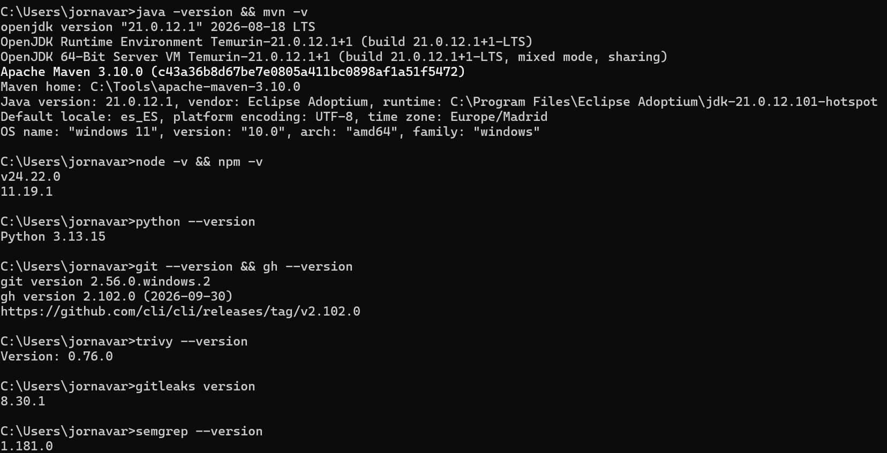

# Día 1: Seguridad y dependencias

## Índice
1. [Versiones](#1-versiones)
2. [Conceptos](#2-conceptos)
3. [Lab 1](#3-lab-1)
   1. [Corregir una vulnerabilidad](#corregir-una-vulnerabilidad)
4. [Lab 2](#4-lab-2)
   1. [Corregir una vulnerabilidad](#corregir-una-vulnerabilidad-1)
5. [Lab 3](#5-lab-3)
6. [Comprobaciones](#6-comprobaciones)

## 1. Versiones



## 2. Conceptos
- **CVE (Common Vulnerability and Exposures)**: es un diccionario creado por la comunidad enfocado a las vulnerabilidades de la ciberseguridad.
- **CWE (Common Weakness Enumeration)**: es un diccionario creado por la comunidad enfocado a las debilidades de software y hardware que podrían tener repercusiones en la seguridad.
- **CVSS (Common Vulnerability Scoring System)**: es una forma de coger las características de una vulnerabilidad y producir un valor numérico de lo severo que es.
- **GHSA (GitHub Security Advisory)**: es una base de datos que tiene vulnerabilidades de software y malware de código abierto.
- **SAST (Static Application Security Testing)**: es una metodología de testing y seguridad que analiza el código fuente de una aplicación sin ejecutar el sistema para detectar y corregir vulnerabilidades. Son de caja blanca.
- **SCA (Software Composition Analisis)**: es una práctica de que identifica y gestiona componentes de código abierto o de terceros para encontrar vulnerabilidades conocidas.
- **Secreto**: es un dato confidencial y digital, como tokens, contraseñas en las bases de datos, claves SSH…
- **Dependencia directa**: es la dependencia que se incluye en el proyecto, es decir, la que se instala en el proyecto y se usa visiblemente.
- **Dependencia transitiva**: son las dependencias usadas por las dependencias que están incluidas en el proyecto.
- **lockfile**: es un archivo que contiene todas las versiones de las dependencias que un proyecto tiene. Evita cambios en las versiones de las dependencias.
- **SBOM (Software Bill of Materials)**: es como una base de datos que lista todos los componentes, librerías, dependencias y más de terceros para ver si tu código esta afectado por una vulnerabilidad de seguridad sin necesidad de hacer una búsqueda manual.
- **Severidad**: que tan grave o peligroso es algo.
- **Exposición**: es el hecho de ser vulnerable a amenazas por exponerse.
- **Aviso**: es una advertencia que indica vulnerabilidades futuras.
- **Alerta**: es una advertencia en tiempo real de una vulnerabilidad o ataque en curso.


## 3. Lab 1

<table style="border: 1px solid white">
    <tr >
        <th style="border-bottom: 1px solid white">Libreria</th>
        <td style="border-bottom: 1px solid white">io.micrometer:micrometer-core</td>
    </tr>
    <tr>
        <th style="border-bottom: 1px solid white">Vulnerabilidad</th>
        <td style="border-bottom: 1px solid white">CVE-2026-40984</td>
    </tr>
    <tr>
        <th style="border-bottom: 1px solid white">Cadena de dependencias</th>
        <td style="border-bottom: 1px solid white">
            org.springframework.samples:spring-petclinic:jar:2.4.0.BUILD-SNAPSHOT
            <br>-> org.springframework.boot:spring-boot-starter-actuator:jar:2.4.1:compile
            <br>-> io.micrometer:micrometer-core:jar:1.6.2:compile
        </td>
    </tr>
    <tr>
        <th style="border-bottom: 1px solid white">Desplegado</th>
        <td style="border-bottom: 1px solid white">En producción y desplegado</td>
    </tr>
    <tr>
        <th style="border-bottom: 1px solid white">Versión</th>
        <td style="border-bottom: 1px solid white">1.6.2</td>
    </tr>
    <tr>
        <th style="border-bottom: 1px solid white">Versión con arreglo</th>
        <td style="border-bottom: 1px solid white">1.15.12, 1.16.6</td>
    </tr>
    <tr>
        <th style="border-bottom: 1px solid white">Corrección</th>
        <td style="border-bottom: 1px solid white">
            Subir a la nueva versión, ya que arregla el CVE. No se puede subir el padre debido a que necesita estar en la versión 3.x.x de SpringBoot, lo que significa que no se podrá llevar de manera limpia.
        </td>
    </tr>
</table>

<table style="border: 1px solid white">
    <tr >
        <th style="border-bottom: 1px solid white">Libreria</th>
        <td style="border-bottom: 1px solid white">org.apache.logging.log4j:log4j-api</td>
    </tr>
    <tr>
        <th style="border-bottom: 1px solid white">Vulnerabilidad</th>
        <td style="border-bottom: 1px solid white">CVE-2026-49844</td>
    </tr>
    <tr>
        <th style="border-bottom: 1px solid white">Cadena de dependencias</th>
        <td style="border-bottom: 1px solid white">
            org.springframework.samples:spring-petclinic:jar:2.4.0.BUILD-SNAPSHOT
            <br>-> org.springframework.boot:spring-boot-starter-actuator:jar:2.4.1:compile
            <br>-> org.springframework.boot:spring-boot-starter:jar:2.4.1:compile
            <br>-> org.springframework.boot:spring-boot-starter-logging:jar:2.4.1:compile
            <br>-> org.apache.logging.log4j:log4j-to-slf4j:jar:2.13.3:compile
            <br>-> org.apache.logging.log4j:log4j-api:jar:2.13.3:compile
        </td>
    </tr>
    <tr>
        <th style="border-bottom: 1px solid white">Desplegado</th>
        <td style="border-bottom: 1px solid white">En producción y desplegado</td>
    </tr>
    <tr>
        <th style="border-bottom: 1px solid white">Versión</th>
        <td style="border-bottom: 1px solid white">2.13.3</td>
    </tr>
    <tr>
        <th style="border-bottom: 1px solid white">Versión con arreglo</th>
        <td style="border-bottom: 1px solid white">2.25.5, 2.26.1</td>
    </tr>
    <tr>
        <th style="border-bottom: 1px solid white">Corrección</th>
        <td style="border-bottom: 1px solid white">
            Subir de versión a la transitiva a la 2.25.5. La dependencia directa que lo introduce, spring-boot-starter, necesita la versión 4.x.x para que se corrija el CVE, lo que no sería una actualización limpia.
        </td>
    </tr>
</table>

<table style="border: 1px solid white">
    <tr >
        <th style="border-bottom: 1px solid white">Libreria</th>
        <td style="border-bottom: 1px solid white">org.thymeleaf:thymeleaf-spring5</td>
    </tr>
    <tr>
        <th style="border-bottom: 1px solid white">Vulnerabilidad</th>
        <td style="border-bottom: 1px solid white">CVE-2021-43466</td>
    </tr>
    <tr>
        <th style="border-bottom: 1px solid white">Cadena de dependencias</th>
        <td style="border-bottom: 1px solid white">
            org.springframework.samples:spring-petclinic:jar:2.4.0.BUILD-SNAPSHOT
            <br>-> org.springframework.boot:spring-boot-starter-thymeleaf:jar:2.4.1:compile
            <br>-> org.thymeleaf:thymeleaf-spring5:jar:3.0.11.RELEASE:compile
        </td>
    </tr>
    <tr>
        <th style="border-bottom: 1px solid white">Desplegado</th>
        <td style="border-bottom: 1px solid white">En producción y desplegado</td>
    </tr>
    <tr>
        <th style="border-bottom: 1px solid white">Versión</th>
        <td style="border-bottom: 1px solid white">3.0.11.RELEASE</td>
    </tr>
    <tr>
        <th style="border-bottom: 1px solid white">Versión con arreglo</th>
        <td style="border-bottom: 1px solid white">3.0.13.RELEASE</td>
    </tr>
    <tr>
        <th style="border-bottom: 1px solid white">Corrección</th>
        <td style="border-bottom: 1px solid white">
            Subir de versión a la transitiva a la 3.0.13.RELEASE. Arregla el CVE.
        </td>
    </tr>
</table>

### Corregir una vulnerabilidad
He aplicado la corrección a io.micrometer:micrometer-core poniendo la versión nueva en properties (<micrometer.version>1.15.12</micrometer.version>).
Al hacer este cambio compila y pasa todos los tests. Luego, al pasar trivy se ha quitado solamente el aviso de la vulnerabilidad de io.micrometer:micrometer-core y no ha añadido ningún aviso nuevo.

## 4. Lab 2
Eligido versión 16.0.0 de Dic de 2023.

La cantidad de avisos que salen son **125 vulnerabilities (5 low, 34 moderate, 70 high, 16 critical)**, de las cuales salen a **producción 68 vulnerabilities (3 low, 23 moderate, 28 high, 14 critical)**.

Con el package-lock.json salen 171 vulnerabilidades, mientras sin él no sale ninguna.

### Corregir una vulnerabilidad 
Paquete: **handlebars version 4.7.9**. Que viene de hbs@4.3.1 -> handlebars@4.7.9
En este caso elijo la versión 4.7.10 ya que corrige todas las vulnerabilidades de ese paquete y es la última versión disponible.
Yo elegiría subir una dependencia actualizada, ya que con overrides es un cambio más temporal y para un parche de este estilo lo mejor sería usar directamente la librería.

## 5. Lab 3
````
src\main\java\org\owasp\webgoat\lessons\challenges\challenge5\Assignment5.java
   ❯❯❱ java.spring.security.injection.tainted-sql-string.tainted-sql-string
          ❰❰ Blocking ❱❱
          User data flows into this manually-constructed SQL string. User data 
          can be safely inserted into SQL strings using prepared statements or 
          an object-relational mapper (ORM). Manually-constructed SQL strings is 
          a possible indicator of SQL injection, which could let an attacker 
          steal or manipulate data from the database. Instead, use prepared 
          statements connection.PreparedStatement`) or a safe library.
          Details: https://sg.run/9rzz
           45┆ "select password from challenge_users where userid = '"
           46┆     + username_login
           47┆     + "' and password = '"
           48┆     + password_login
           49┆     + "'");
````
**Tipo: REAL**, ya que no es un test ni una utilidad y es una query que se usa el usuario en producción por lo que puede ser aprovechada.

````
    src\main\resources\webgoat\static\js\libs\ace.js
    ❯❱ javascript.browser.security.wildcard-postmessage-configuration.wildcard-postmessage-configuration
          ❰❰ Blocking ❱❱
          The target origin of the window.postMessage() API is set to "*". This 
          could allow for information disclosure due to the possibility of any 
          origin allowed to receive the message.                  
          Details: https://sg.run/PJ4p
           1740┆ win.postMessage(messageName, "*");
````
**Tipo: código que no se despliega**, como se ve en la ruta es una dependecia que podría no ejecutarse.

````
src\main\java\org\owasp\webgoat\lessons\cryptography\EncodingAssignment.java
    ❯❱ java.lang.security.audit.tainted-session-from-http-request.tainted-session-from-http-request
          ❰❰ Blocking ❱❱
          Detected input from a HTTPServletRequest going into a session command, 
          like `setAttribute. User input into such a command could lead to an 
          attacker inputting malicious code into your sesión parameters, blurring 
          the line between what's trusted and untrusted, and therefore leading to 
          a trust boundary violation. This could lead to programmers trusting 
          unvalidated data. Instead, thoroughly sanitize user input before 
          passing it into such function calls.
          Details: https://sg.run/QbDZ
           39┆ request.getSession().setAttribute("basicAuth", basicAuth);
````
**Tipo: REAL**, si se llegaría a ejecutar por donde esta localizado y no es un test ni log.

````
.github\workflows\release.yml
❯❯❱ yaml.github-actions.security.run-shell-injection.run-shell-injection
          ❰❰ Blocking ❱❱
          Using variable interpolation `${{...}}` with `github` context data in a 
          `run:` step could allow an attacker to inject their own code into the 
          runner. This would allow them to steal secrets and code. `github` 
          context data can have arbitrary user input and should be treated as 
          untrusted. Instead, use an intermediate environment variable with 
          `env:` to store the data and use the environment variable in the `run:` 
          script. Be sure to use double-quotes the environment variable, like 
          this: "$ENVVAR".
          Details: https://sg.run/pkzk
           24┆ run: |
           25┆   echo "WEBGOAT_TAG_VERSION=${{ github.ref_name }}" >> $GITHUB_ENV
           26┆   WEBGOAT_MAVEN_VERSION=${{ github.ref_name }}
           27┆   echo "WEBGOAT_MAVEN_VERSION=${WEBGOAT_MAVEN_VERSION:1}" >> GITHUB_ENV
````
**Tipo: REAL**, ya que es un código de despliegue que si se va a ejecutar.

````
src\main\java\org\owasp\webgoat\lessons\pathtraversal\ProfileUploadRetrieval.java
   ❯❯❱ java.lang.security.httpservlet-path-traversal.httpservlet-path-traversal
          ❰❰ Blocking ❱❱
          Detected a potential path traversal. A malicious actor could control 
          the location of this file, to include going backwards in the directory 
          with '../'. To address this, ensure that user-controlled 
          variables in file paths are sanitized. You may also consider using a 
          utility method such as org.apache.commons.io.FilenameUtils.getName(...) 
          to only retrieve the file name from the path.
          Details: https://sg.run/oxXN
          100┆ var catPicture =
          101┆     new File(catPicturesDirectory, (id == null ? RandomUtils.nextInt(1, 11) : id) + jpg");   
````
**Tipo: REAL**, si se llega a ejecutar al no ser un test ni librería.

## 6. Comprobaciones

1.	**¿Por qué un aviso crítico puede no ser lo primero que hay que corregir?**
    Porque puede necesitar una versión mayor que llevaría a actualizar el proyecto entero o porque esta aislado y no supone un riego tan grande o porque se necesitan condiciones muy especificas para que se de uso a la vulnerabilidad

2.	**¿Qué pierde una herramienta de escaneo si el repositorio no tiene lockfile?**
    Pues en mi caso todo, no puede escanear si tiene vulnerabilidades el proyecto, creo que no puede ejecutar con certeza el escaneo ya que no sabe que dependencia tiene.
3.	**¿Por qué preferimos corregir en el origen y no forzar la versión?**
    Porque forzar la versión es una medida temporal, ya que solo afecta a esa dependencia y en actualizaciones futuras se podría llegar a necesitar a quitar el forzar de la versión.
4.	**Si el mismo aviso aparece en dos manifiestos del mismo repositorio, ¿cuántos avisos son y cuántas alertas?**
    Genera 2 alertas ya que esta en 2 manifiestos, pero luego como solo hay 1 vulnerabilidad solo se genera 1 aviso.
